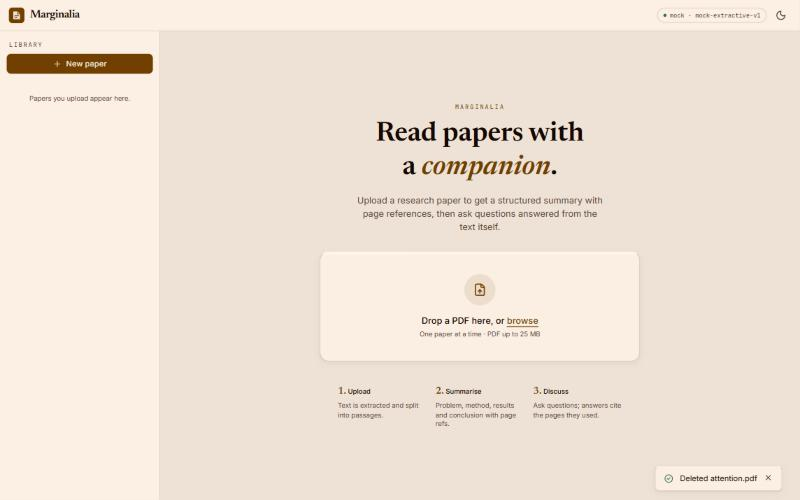
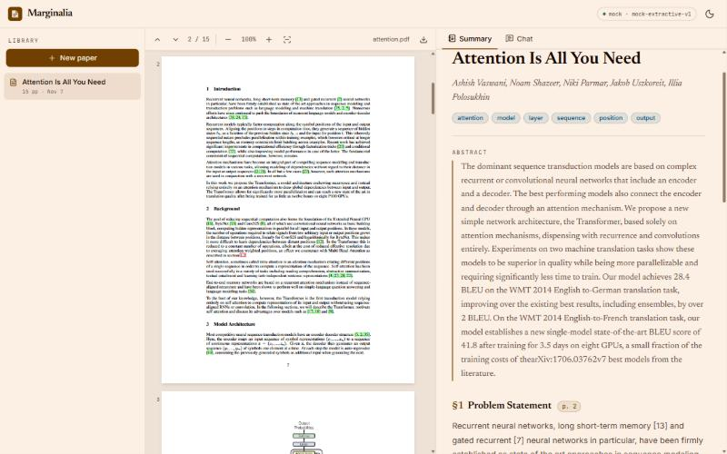
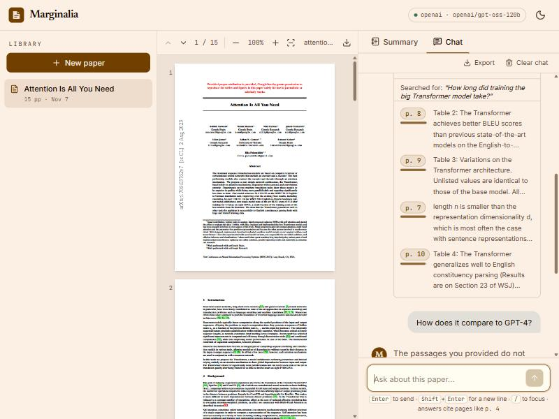
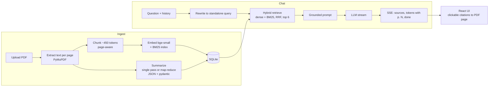

# Marginalia: research-paper summarizer + chat

Upload a research-paper PDF and get a structured summary (title, authors, abstract, problem statement,
methodology, key results, conclusion), then chat with the paper. Answers are grounded in retrieved passages
(RAG), stream in token by token and cite the pages they came from. The page badges jump the PDF viewer to the
right page. A React front end talks to a FastAPI back end, and the whole app works **without an API key** thanks to a
built-in extractive `mock` provider, so you can try it right after cloning.

| Home | Summary + PDF | Chat with citations |
|---|---|---|
|  |  |  |

## Features

**Required**
- Upload one research-paper PDF (drag-and-drop or picker, ≤ 25 MB) with progress and validation.
- Structured summary: Title / Authors / Abstract, Problem Statement, Methodology, Key Results, Conclusion.
- Chat with the paper through an LLM using retrieval-augmented generation, with follow-up questions.

**Extras**
- **Page-linked everything**: every summary section has `p. N` badges and every chat answer has inline `[p. N]`
  citations. Clicking one scrolls the PDF viewer to that page.
- **Side-by-side PDF viewer** (pdf.js) next to the Summary / Chat tabs; panes become tabs on phones.
- **Hybrid retrieval**: local dense embeddings (`bge-small`) + BM25, merged with Reciprocal Rank Fusion.
- **Follow-up rewriting**: "How long did it take?" becomes a standalone query before retrieval, and the UI shows how
  it was interpreted.
- **Map-reduce summarizer** for long papers, with pydantic validation and one automatic retry.
- **Streaming chat** over SSE with Stop, retry, suggested questions, collapsible retrieved sources.
- **Export**: summary as Markdown (download or copy), print/save as PDF, chat as Markdown.
- **Provider-agnostic**: Anthropic, OpenAI, any OpenAI-compatible server (Ollama, Groq, OpenRouter) or the offline mock.
- Library of past papers (persisted in SQLite), light/dark theme, error toasts, 17 backend tests,
  Docker setup, one-command start scripts.

## Quick start

Requirements: Python 3.12+, Node 20+. No API key needed: the default provider is `mock`.

### 1. One command

```powershell
# Windows
powershell -ExecutionPolicy Bypass -File scripts\dev.ps1
```
```bash
# macOS / Linux
./scripts/dev.sh
```

The script creates `backend/.venv`, installs backend and frontend dependencies, copies `backend/.env.example` to
`backend/.env` if missing, then starts the API on <http://localhost:8000> and the UI on <http://localhost:5173>.
The first upload downloads the ~70 MB embedding model once (set `EMBEDDING_BACKEND=hash` in `backend/.env` to skip
it when offline).

### 2. Manual

```bash
# terminal 1: backend
cd backend
python -m venv .venv
.venv\Scripts\activate          # macOS/Linux: source .venv/bin/activate
pip install -r requirements.txt
cp .env.example .env            # optional, defaults work
uvicorn app.main:app --port 8000

# terminal 2: frontend
cd frontend
npm install
npm run dev                     # http://localhost:5173, proxies /api to :8000
```

### 3. Docker

```bash
docker compose up --build       # UI on http://localhost:8080
```

The app has no login, so Docker publishes it on this computer only. To share it on a network, remove `127.0.0.1:` from
the port in `docker-compose.yml` and add your hostname to `ALLOWED_HOSTS`.

Runs with the mock provider by default. Pass `LLM_PROVIDER`, `ANTHROPIC_API_KEY` etc. as environment variables or in
a `.env` file next to `docker-compose.yml`. Papers persist in the `paper-data` volume.

### Trying it

1. Open the UI and drop in any text-based research PDF (for example <https://arxiv.org/pdf/1706.03762>).
2. Wait a few seconds for the summary. Click a `p. N` badge to jump to that page.
3. Open **Chat**, ask a question, then a follow-up. Click a `[p. N]` citation or expand **Sources**.
4. Use **Download .md** on the summary, or delete the paper from the library.

With the mock provider the summary and answers are extractive (sentences lifted from the paper), so they are
less fluent than a real model's but fully exercise the pipeline.

## Configuration

Set these in `backend/.env` (or the environment).

| Variable | Default | Notes |
|---|---|---|
| `LLM_PROVIDER` | `mock` | `mock` \| `anthropic` \| `openai` |
| `LLM_MODEL` | per provider | `claude-sonnet-5-5` / `gpt-4o-mini` |
| `ANTHROPIC_API_KEY` | – | for `anthropic` |
| `OPENAI_API_KEY` | – | for `openai` (any value for local servers) |
| `OPENAI_BASE_URL` | – | OpenAI-compatible endpoints |
| `EMBEDDING_BACKEND` | `fastembed` | `fastembed` or `hash` (no download) |
| `CHUNK_TOKENS` | `450` | estimated embedder tokens per chunk; keep under the embedder's 512-token window |
| `CHUNK_OVERLAP_TOKENS` | `60` | changing either chunk value or the embedding model re-indexes existing papers on the next start |
| `TOP_K` | `6` | passages sent to the model per chat question (~450 tokens each); lower to `4` on small token quotas |
| `DATA_DIR` | `./data` | PDFs and SQLite DB |
| `MAX_UPLOAD_MB` | `25` | |
| `CORS_ORIGINS` | `http://localhost:5173,http://127.0.0.1:5173` | origins allowed to make browser requests |
| `ALLOWED_HOSTS` | `localhost,127.0.0.1,[::1],backend` | Host names the API accepts (no port). **A deployment on a custom domain must add it here, or every request gets `400 Invalid host header`.** |

```bash
# Claude
LLM_PROVIDER=anthropic
ANTHROPIC_API_KEY=sk-ant-...

# OpenAI
LLM_PROVIDER=openai
OPENAI_API_KEY=sk-...

# Local Ollama (free, no key)
LLM_PROVIDER=openai
OPENAI_BASE_URL=http://localhost:11434/v1
OPENAI_API_KEY=ollama
LLM_MODEL=llama3.1

# Groq free tier (8000 tokens/minute, so shrink the summary pipeline)
LLM_PROVIDER=openai
OPENAI_BASE_URL=https://api.groq.com/openai/v1
OPENAI_API_KEY=gsk_...
LLM_MODEL=openai/gpt-oss-120b
SUMMARY_SINGLE_PASS_TOKENS=4000
SUMMARY_MAP_GROUP_TOKENS=3000
TOP_K=4
```

The screenshots above were taken with the Groq setup (`openai/gpt-oss-120b`). When a provider reports a
tokens-per-minute limit, the backend waits and retries instead of failing.

The header pill in the UI shows which provider and model are active. Details: [backend/README.md](backend/README.md).

## Architecture

More diagrams (repo structure, local runtime, deployment options): [docs/ARCHITECTURE.md](docs/ARCHITECTURE.md).



- **Summary**: short papers go to the model in one call; long ones are split into groups of chunks that produce
  page-cited notes (map), then a reduce step combines them with the first two pages and a section outline.
  Output must validate against the `Summary` schema.
- **Chat**: the retrieved passages are the only context. The prompt tells the model to cite `[p. N]` and to say so
  when the paper doesn't cover the question.
- **Frontend**: Vite + React 19 + TypeScript + Tailwind; SSE is read with `fetch` + `ReadableStream` because the chat
  endpoint is a POST.

## API

Full request/response shapes in [docs/API_CONTRACT.md](docs/API_CONTRACT.md); interactive docs at
<http://localhost:8000/docs>.

| Method | Path | Purpose |
|---|---|---|
| GET | `/api/health` | status, provider, model |
| POST | `/api/papers` | upload a PDF (multipart `file`) |
| GET | `/api/papers`, `/api/papers/{id}` | list / get paper (poll while `processing`) |
| GET | `/api/papers/{id}/pdf` | original PDF |
| POST | `/api/papers/{id}/summary` | regenerate the summary |
| POST | `/api/papers/{id}/chat` | ask a question, SSE stream |
| GET | `/api/papers/{id}/export.md` | summary as Markdown |
| DELETE | `/api/papers/{id}` | delete the paper |

## Tests

```bash
cd backend && pytest             # upload, summary shape, SSE chat, delete, error cases, units
cd frontend && npm run lint && npm run build
```

Backend tests generate their own PDFs and use the mock provider, hash embeddings and a temp directory, so they need
no network or key.

## Project structure

```
backend/    FastAPI app (app/), pytest suite (tests/), Dockerfile
frontend/   Vite React app (src/), Dockerfile + nginx.conf
docs/       API_CONTRACT.md, ARCHITECTURE.md, screenshots/
scripts/    dev.ps1 (Windows) and dev.sh (macOS/Linux) one-command start
docker-compose.yml
```

## AI-assisted development

This project was built with **Claude Code**, using it as the AI-assisted workflow in place of tools like Cursor,
Lovable or Vercel's v0. Those tools were not used. Claude Code filled that role:

1. A **coordinator session** wrote the plan and the shared **API contract** ([docs/API_CONTRACT.md](docs/API_CONTRACT.md))
   first, so the two halves could be built independently.
2. It then delegated to **parallel worker sessions**, one for the backend and one for the frontend. Each worked against
   the contract (the frontend against an in-browser mock of it) and committed only its own folder, in small commits;
   see `git log`.
3. A final **integration pass** ran the real app end to end in a browser (upload, summary, page badges, chat with a
   follow-up, citations, export, delete), added the start scripts, Docker setup and this README.

All code was reviewed and verified by running it: tests, lint, build, and a browser check.

## Limitations / future work

- Text-based PDFs only. Scanned papers (no text layer) are rejected; OCR is not included.
- The mock provider is extractive: summaries and answers are sentences from the paper, and table-heavy pages can
  produce noisy text. A real LLM gives much better output.
- Text extraction can leave small artifacts (for example an arXiv stamp glued onto a sentence).
- One paper at a time for upload and chat; no cross-paper questions.
- Page citations show where an answer came from, but they can't prove the answer is right: a model can cite the
  correct page and still get a detail wrong, such as attaching a score to the wrong dataset. Check important claims
  against the PDF.
- No authentication, rate limits, spending cap or multi-user separation: it is a single-user local app. Don't put it on
  a public URL as is, because anyone who finds it could use up your API credit.
- Summaries on free-tier APIs are slow: about 2 minutes for a 15-page paper on Groq, and longer for big papers.
- Chat history lives in the browser's `localStorage`, not on the server.
- Ideas: figure/table extraction, highlight the cited passage inside the PDF, evaluation of retrieval quality,
  reranking, and multi-paper comparison.

## License

[MIT](LICENSE)
