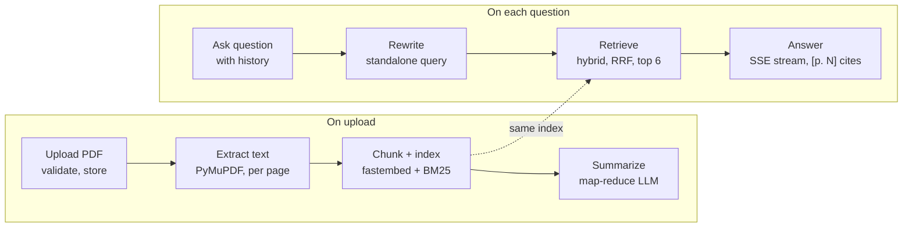
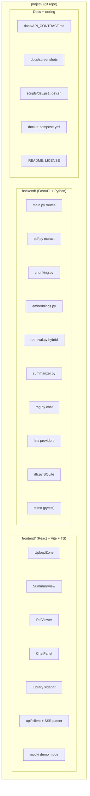
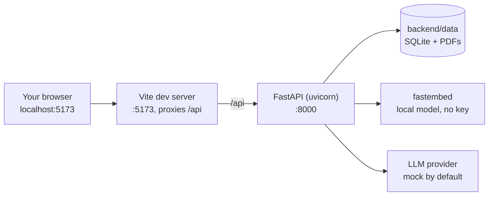
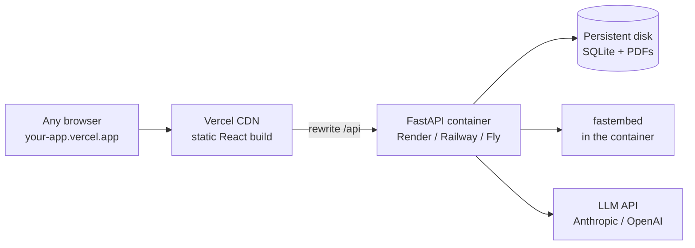
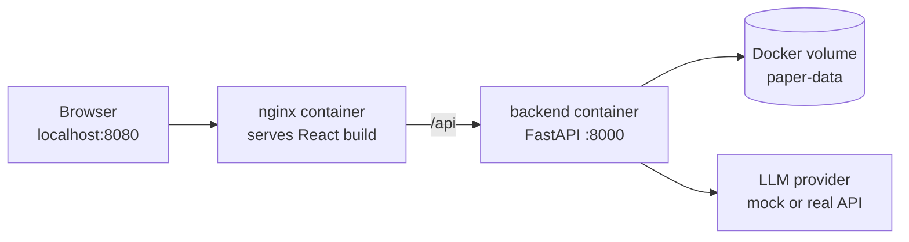

# Architecture

Four views of Marginalia: what happens to a paper, how the repo is organised, how it runs locally, and how it would run when deployed. The diagrams use Mermaid, which GitHub renders automatically.

## 1. Process: from upload to answer

Each upload is processed once, in the background. Every question then reuses the index built at upload.

- **Summarize** produces Title & Authors, Abstract, Problem Statement, Methodology, Key Results and Conclusion, plus keywords, suggested questions and the source pages of each section. The source pages become the clickable `p. N` badges.
- **Rewrite** turns a follow-up like "what about the second one?" into a complete question, so retrieval finds the right passages.
- **Retrieve** merges dense (embedding) and BM25 keyword rankings with reciprocal rank fusion (RRF).
- **Answer** streams token by token and cites pages as `[p. N]`. Clicking a citation jumps the PDF viewer to that page.

## 2. Repository structure

[API_CONTRACT.md](API_CONTRACT.md) was written before either side was built. The frontend and backend were then developed in parallel against it, and the frontend's `mock/` lets it run without the backend.

## 3. Runtime: local development (current)

`scripts/dev.ps1` (Windows) or `scripts/dev.sh` (macOS/Linux) starts both servers.

- The browser only talks to Vite, and Vite forwards `/api` to the backend, so there's no CORS setup in development.
- With `LLM_PROVIDER=mock`, the app works with no API key: summaries and answers are extractive (sentences taken from the paper). Set `LLM_PROVIDER=anthropic` or `openai` (optionally with `OPENAI_BASE_URL` for Ollama and similar) for real LLM output.

## 4. Runtime: deployed full stack

### Option A: hosted (Vercel + container host)

| Concern | Local dev | Deployed |
|---|---|---|
| Frontend | Vite dev server, rebuilds on every edit | `npm run build` → static files on a CDN |
| `/api` routing | Vite proxy | Vercel rewrite (same origin, so no CORS) |
| Storage | `backend/data` folder | Mounted persistent disk (otherwise data is lost on restart) |
| Embeddings | Downloaded on first run | Also downloaded on first run today; pre-download it in the Dockerfile so the first upload is fast |
| LLM | `mock` | Real provider, key stored as a secret, spending cap set |

The backend can't run as Vercel serverless functions: it runs background summarising, streams answers over SSE, and keeps state on disk, so it needs a server that stays up. Free tiers on Render and Railway go to sleep when idle, so the first request after a pause is slow.

### Option B: single machine (Docker Compose)

`docker compose up --build` runs the whole stack on one machine or a single VPS. Pass `LLM_PROVIDER` and the API key as environment variables, or put them in a `.env` file next to `docker-compose.yml`.
